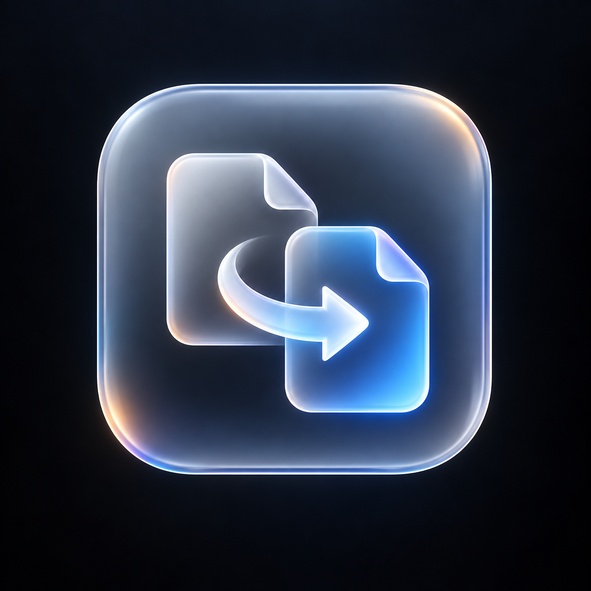

<p align="center">
  
</p>

<h1 align="center">Swish</h1>

<p align="center">
  <strong>Convert any file on macOS in a single gesture with pure Liquid Glass.</strong>
</p>

<p align="center">
  
  
  
  
</p>

---

## Overview

**Swish** is an ultra-premium, silent background utility for macOS that makes file conversion instantaneous. 

Instead of opening heavy conversion software or uploading sensitive files to online web converters, simply **drag any file in Finder and hold `⌘ Command`**. A cursor-anchored **Pure Liquid Glass Petal Wheel** materializes with live hardware blur, offering only genuine, offline formats. Release the file over your target format, and Swish converts it instantly beside the original with collision-safe naming.

---

## ✨ Features

- **Gesture-Driven**: Drag any file in Finder + hold `⌘ Command` to summon the wheel at your cursor.
- **Pure Liquid Glass Aesthetic**: Custom curved radial petals rendered with real-time backdrop blur (`NSVisualEffectView`), white specular rim highlights, and zero grey backing plates.
- **Fixed-Geometry Highlight**: Petals highlight with light refraction on hover without distracting size popups or scale jumps.
- **Apple Green Success Wave**: Concentric glowing green shockwaves burst outward around a crisp checkmark tick on successful conversion.
- **Universal ZIP Archiving**: Every supported file type includes a one-click `ZIP` compress option. Single files become `<Name>.zip`; multiple dropped files become `Archive.zip`.
- **Rock-Solid WebP Pipeline**: Offline WebP conversion engine for both images and documents.
- **Smart Format Filtering**: Only genuinely convertible formats are displayed. Self-conversions (e.g., PNG $\to$ PNG) and obsolete formats (TIFF, BMP, RTF) are excluded.
- **Unsupported Format Guard**: If an unsupported file (e.g., `.exe`, `.dmg`, `.pkg`) is dragged, Swish displays a sleek floating liquid glass pill: `File not supported for conversion`.
- **100% Offline & Private**: Zero telemetry, zero analytics, zero network requests. Your files never leave your Mac.

---

## 🎯 Supported Formats

| File Category | Convertible Targets | Notes |
| :--- | :--- | :--- |
| **Images** (`.png`, `.jpg`, `.webp`, `.heic`, `.gif`, `.svg`, etc.) | **WEBP**, **JPEG**, **PNG**, **PDF**, **HEIC**, **GIF**, **ZIP** | Lossless & high-quality color profile preservation via ImageIO + libwebp |
| **PDF Documents** (`.pdf`) | **PNG**, **JPEG**, **WEBP**, **HEIC**, **TXT**, **ZIP** | 300 DPI Retina page rendering via PDFKit & full text stream extraction |
| **Presentations** (`.pptx`, `.ppt`, `.key`, `.odp`) | **PDF**, **PNG**, **JPEG**, **WEBP**, **ZIP** | High-definition slide vector capture via QuickLook Thumbnailing |
| **Videos** (`.mov`, `.mp4`, `.m4v`, `.avi`, `.mkv`) | **MP4**, **MOV**, **GIF**, **M4A**, **WAV**, **PNG**, **JPEG**, **ZIP** | AVFoundation H.264/HEVC transcode, 10fps animated GIF loop, audio extraction |
| **Audio** (`.mp3`, `.m4a`, `.wav`, `.aiff`, `.caf`, etc.) | **M4A**, **WAV**, **AIFF**, **CAF**, **AAC**, **FLAC**, **ZIP** | CoreAudio PCM, AAC 256k, Apple Lossless, and lossless audio |
| **Documents / Code** (`.txt`, `.md`, `.json`, `.py`, `.swift`, etc.) | **PDF**, **TXT**, **HTML**, **PNG**, **ZIP** | CoreText typography layout and formatting |
| **Unsupported Files** | *Floating Indicator Pill* | Displays `File not supported for conversion` |

---

## 📦 Installation

### Method 1: Download `.DMG` (Recommended)

1. Download **[Swish.dmg](Swish.dmg)** from this repository.
2. Double-click `Swish.dmg` to mount the disk image.
3. Drag **Swish.app** into the **Applications** folder shortcut.
4. Launch **Swish** from Applications or Spotlight.

> [!NOTE]
> On first launch, macOS will request **Accessibility permissions** (`System Settings > Privacy & Security > Accessibility`). This permission is required by macOS so Swish can detect the `⌘ Command` key while Finder is in an active drag session.

---

## 🛠️ Building from Source

Swish is built entirely with native Swift and AppKit. No third-party packages or CocoaPods required.

```bash
# Clone the repository
git clone https://github.com/krishbuilds01/Swish.git
cd Swish

# Build production binary
swift build -c release

# Bundle into Swish.app
mkdir -p Swish.app/Contents/MacOS
cp .build/release/Swish Swish.app/Contents/MacOS/Swish
codesign --force --deep --sign - Swish.app

# Open the app
open Swish.app
```

---

## 🚀 How to Use

1. Click and drag any file or group of files in Finder.
2. While dragging, hold the **`⌘ Command`** key.
3. The **Liquid Glass Wheel** will appear centered at your cursor.
4. Move your mouse over your desired target format petal.
5. Drop the file. Swish converts it instantly beside the original file!

---

## 📄 License

MIT License. Crafted with precision for macOS.
